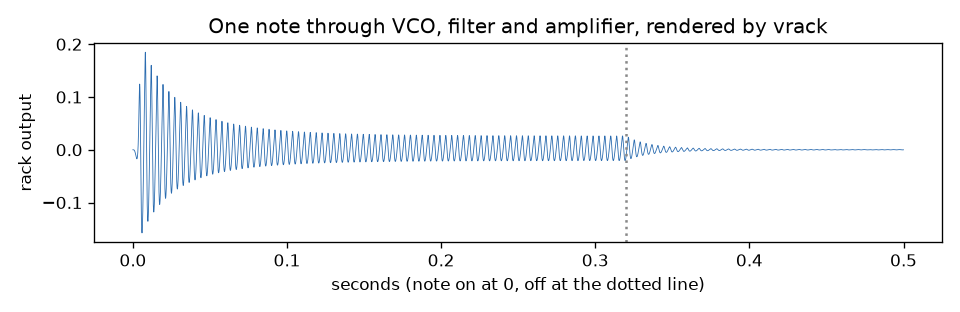

OmniPython's audioinstruments is a set of playable synthesizers, organs and electric pianos, each one a patch of modules on a virtual rack, rendered a block at a time on [audiodsp](https://github.com/PyDevices/audiodsp), on CPython and on MicroPython-compatible firmware.

## Install

You need Python 3.12 or later, numpy and audiodsp (from TestPyPI until its release):

```sh
uv venv --seed --python 3.12 .venv
uv pip install --python .venv/bin/python -i https://test.pypi.org/simple/ \
    --extra-index-url https://pypi.org/simple/ omnipython-audiodsp numpy
git clone https://github.com/PyDevices/audioinstruments && cd audioinstruments
```

## Try it

```python
import audiocore
from vrack import adapter

inst = adapter.create(48000, voice="poly106")
print(inst.macro_labels[:4])
inst.note_on(60, 100)
for n in range(6):
    inst.fill()
    result, data = audiocore.get_buffer(inst.output, False, 0)
    samples = memoryview(bytes(data)).cast("h")
    print(n, max(abs(s) for s in samples))
inst.deinit()
```

Run it with `PYTHONPATH=lib .venv/bin/python example.py`. It plays middle C on the Poly106 and prints its first four knobs, then the loudest sample of each buffer as the note sounds:

```
('vcf_freq', 'vcf_res', 'vcf_env', 'env_attack')
0 3673
1 5483
2 4779
3 4561
4 4411
5 4233
```

[Docs](docs/overview.md) · [Examples](examples/) · [Roadmap](ROADMAP.md)

OmniPython is made by [PyDevices](https://pydevices.com).
